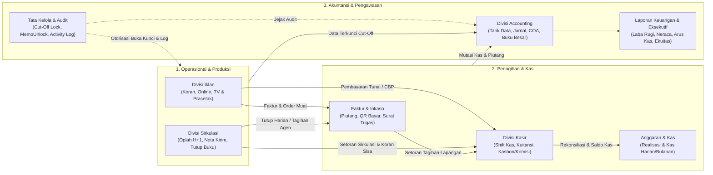

<div align="center">


# SIKAPRI — Sistem Informasi Manajemen Pers Terpadu

**PT Berkah Pikiran Rakyat (Harian Umum Kabar Priangan)**
*Enterprise Newsroom, Advertising, Circulation, Cashier, Inkaso & General Ledger System*

[](https://www.php.net/)
[](https://laravel.com/)
[](https://tailwindcss.com/)
[](https://alpinejs.dev/)
[](https://phpunit.de/)
[](#)

</div>

---

## 1. Ringkasan Eksekutif

**SIKAPRI** (*Sistem Informasi Kabar Priangan*) adalah platform operasional terintegrasi berbasis web milik **PT Berkah Pikiran Rakyat** untuk mengelola seluruh siklus bisnis media massa regional Priangan Timur (Tasikmalaya, Ciamis, Banjar, Garut, Sumedang, dan sekitarnya) secara terpusat, akuntabel, dan siap audit.

Sistem ini menyatukan operasi **6 lini utama perusahaan**:
1. **Divisi Iklan & Pracetak** — Iklan Koran Cetak (Baris, Kolom, Display, Advertorial), Portal Online, dan Priangan TV.
2. **Divisi Sirkulasi & Distribusi** — Pengelolaan alokasi oplah harian agen, ekspedisi rute subuh, nota kirim percetakan, kalkulasi penjualan, serta laporan standar Serikat Perusahaan Pers (SPS).
3. **Divisi Keuangan, Faktur & Inkaso** — Penerbitan faktur piutang, QR pembayaran, penugasan penagih lapangan (*inkaso*), pengendalian anggaran, dan manajemen kas.
4. **Divisi Kasir** — Penerimaan tunai/transfer lintas divisi, kontrol shift kasir harian, pengeluaran kasbon/komisi, dan cetak kuitansi resmi.
5. **Divisi Accounting & General Ledger (GL)** — Penarikan data transaksi terkunci, penjurnalan otomatis, buku besar, neraca lajur, hingga penyusunan laporan keuangan korporasi.
6. **Administrator & Tata Kelola Sistem** — Manajemen pengguna berbasis peran (*RBAC*), audit log aktivitas, konfigurasi sistem, monitoring, laporan eksekutif, dan pencadangan basis data.

---

## 2. Arsitektur Alur Bisnis & Integrasi Antar-Divisi



---

## 3. Cakupan Modul Fungsional

### A. Divisi Iklan & Pracetak
- Transaksi terpisah untuk **Iklan Koran** (Baris, Kolom, Display, Advertorial), **Iklan Online**, dan **Priangan TV** lengkap dengan kalkulasi PPN dan penomoran faktur atomik.
- Manajemen **Master Pelanggan**, **Jenis Iklan**, **Kategori Media**, **Kop Iklan**, **Kop Kota**, dan **Sales / Account Executive (AE)**.
- Validasi **SPPI**, penjadwalan muat (*Order Jadwal Muat*), **Rekap Pracetak Harian**, serta laporan kinerja sales, insentif AE, klasifikasi iklan, dan pembatalan.

### B. Divisi Sirkulasi & Distribusi
- **Input & Salin Oplah Harian (`H+1`)**: Kalkulasi real-time total eksemplar dan estimasi omset, deteksi perubahan kontekstual (*dirty-state tracking* + tombol Batal/Simpan), serta fitur **Salin Oplah** dengan proteksi anti-timpa.
- **Nota Kirim Percetakan (6 Slip per Lembar A4 Portrait)**: Cetak massal hitam-putih berdensitas tinggi (`Margin 0`, siap gunting) dengan filter **Tanggal Edisi** (mendukung *reprint* edisi lama), **Rute Armada**, dan **Pencarian Agen/Wilayah**.
- **Pengaturan Tarif & Komposisi Oplah (`SistemConfig`)**: Pengelolaan terpusat harga agen besar, harga eceran, harga langganan, isi per ikat/bendel, rasio default oplah, dan jam *cut-off* tanpa hardcode.
- **Tutup Buku & Proteksi Audit**: Penguncian transaksi harian/bulanan yang terintegrasi dengan `DailyCutoff`, `LogHitungAkuntansi`, dan `PeriodeAkuntansi` (otomatis *read-only* jika sudah tutup buku atau ditarik Akuntansi, kecuali dibuka melalui **Memo Buka Kunci** yang disetujui Akuntansi).
- **Laporan Pemasaran & Penjualan**: Rekap per agen besar, sub-agen/kios, 8 wilayah pemasaran, 15 rute armada, hingga laporan **Audit Tiras Standar SPS**.

### C. Divisi Keuangan, Faktur & Penagihan Lapangan (Inkaso)
- Pengelolaan **Piutang Faktur Iklan & Sirkulasi**, faktur tunai, faktur susulan, *stopper bonus*, dan **Stok Opname Faktur**.
- **Inkaso Lapangan**: Penugasan kolektor manual (tanpa perlu akun login kolektor), cetak **Surat Tugas Penagihan**, pemantauan penugasan aktif, dan input setoran piutang terintegrasi Kasir.
- **QR Pembayaran Faktur** (`FakturQrPembayaran`) dan **Pengendalian Anggaran & Kas**.

### D. Divisi Kasir
- Kontrol **Shift Kasir Harian** (`EnsurePreviousShiftClosed`) yang memastikan shift sebelumnya ditutup dengan seimbang sebelum membuka shift baru.
- Penerimaan kas tunai maupun mutasi bank (iklan, sirkulasi, koran sisa), pengeluaran kasbon dan komisi, pencetakan **Kuitansi Resmi**, serta modul **Koreksi / Buka Kas Terkendali**.

### E. Divisi Accounting & General Ledger
- **Chart of Accounts (COA)**, **Jurnal Umum**, **Jurnal Memorial**, **Buku Besar**, dan **Neraca Lajur**.
- Penarikan & hitung penjualan/pembayaran dari Divisi Iklan & Sirkulasi secara terkunci, manajemen **Beban Akrual, Anggaran & Aset Tetap**, mutasi bank, serta **Buka Data Terotorisasi**.
- Cetak laporan resmi: **Laba Rugi**, **Neraca**, **Arus Kas**, **Perubahan Ekuitas**, dan **Rincian Beban**.

---

## 4. Tata Kelola Keamanan, Kepatuhan & Integritas Data

Sistem dibangun mengikuti prinsip **CIA Triad** (*Confidentiality, Integrity, Availability*) dan kontrol internal perusahaan pers modern:

| Aspek Pengendalian | Implementasi Teknis di Kode |
|---|---|
| **Kontrol Akses (RBAC)** | Middleware `EnsureUserRole` & `EnsureAccountActive` membatasi rute berdasarkan peran divisi dan status akun (`active`, `review`, `disable`). |
| **Kunci Periode & Cut-Off** | Penguncian berlapis melalui `DailyCutoff`, `PeriodeAkuntansi`, dan `LogHitungAkuntansi` mencegah perubahan data operasional setelah tutup buku atau ditarik ke GL. |
| **Otorisasi Pengecualian** | Pembukaan kunci transaksi pasca-cutoff wajib melalui alur permohonan & persetujuan `MemoUnlock` oleh Divisi Akuntansi. |
| **Zero Hard Delete & Audit Trail** | Penghapusan transaksi historis dicegah; setiap aktivitas kritikal dan perubahan data finansial dicatat ke `ActivityLog` dan `AuditLogAkuntansi`. |
| **Proteksi Peramban & SEO** | Middleware `SecurityHeadersMiddleware` menerapkan header keamanan HTTP dan kebijakan anti-indexing internal. |
| **Pencadangan Terjadwal** | Perintah artisan `RunSystemBackup` serta panel `BackupController` untuk backup basis data terpusat. |

---

## 5. Matriks Peran Pengguna (RBAC)

Definisi peran terpusat pada `app/Models/User.php` dan ditegakkan pada `routes/web.php`:

| Kode Role | Label Divisi | Lingkup Otorisasi Utama |
|---|---|---|
| `administrator` / `admin` | Administrator | Akses penuh lintas modul, manajemen user, backup sistem, monitoring, log aktivitas, dan laporan eksekutif. |
| `iklan` | Divisi Iklan | Transaksi iklan (Koran, Online, TV), master pelanggan/jenis iklan/sales AE, SPPI, dan rekap pracetak. |
| `sirkulasi` | Divisi Sirkulasi | Input & salin oplah harian, cetak nota kirim percetakan, tutup buku harian/bulanan, laporan pemasaran & penjualan, serta pengaturan tarif sirkulasi. |
| `kasir` | Divisi Kasir | Manajemen shift kasir, penerimaan kas/bank, pengeluaran kasbon/komisi, cetak kuitansi, dan laporan posisi kas. |
| `faktur` | Divisi Faktur | Manajemen faktur piutang, stok opname faktur, penugasan inkaso, dan surat tugas tagih. |
| `anggaran` | Divisi Anggaran | Perencanaan, verifikasi, dan pengendalian anggaran operasional serta kas harian/bulanan. |
| `keuangan` / `admin_keuangan` | Divisi Keuangan | Konsolidasi faktur, inkaso, anggaran, serta pengawasan arus kas. |
| `petugas_inkaso` | Petugas Inkaso | Akses operasional penagihan lapangan dan cetak surat tugas inkaso. |
| `accounting` | Divisi Accounting | COA, penarikan & hitung data iklan/sirkulasi, jurnal umum/memorial, buku besar, neraca lajur, laporan keuangan, dan otorisasi buka kunci. |
| `kepala_divisi` | Kepala Divisi | Akses pemantauan dan otorisasi tingkat pimpinan divisi. |

---

## 6. Spesifikasi Teknologi

- **Backend:** PHP `^8.4`, Laravel Framework `^12.0`, Laravel Breeze `^2.3`, Laravel Tinker `^2.10`
- **Frontend:** Blade Server-Side Rendering, Tailwind CSS `^3.1` (`@tailwindcss/forms`), Alpine.js `^3.4`, Vite `^7.0`
- **Utilitas:** `simplesoftwareio/simple-qrcode` (QR Faktur & Verifikasi Pembayaran)
- **Kualitas & Pengujian:** PHPUnit `^11.5`, Laravel Pint `^1.24`, Laravel Pail `^1.2`

---

## 7. Struktur Direktori Utama

```text
si-kabarapriangan/
├── app/
│   ├── Console/Commands/        # Command backup otomatis & otomasi sistem
│   ├── Http/
│   │   ├── Controllers/         # Controller Iklan, Sirkulasi, Kasir, Accounting, Keuangan & Admin
│   │   └── Middleware/          # RBAC (EnsureUserRole), Status Akun, Shift Kasir & Security Headers
│   ├── Models/                  # Eloquent Models lintas divisi, COA, Jurnal, Cutoff & MemoUnlock
│   └── Services/                # Layanan domain (KalenderNasionalService, dll.)
├── database/
│   ├── migrations/              # Skema tabel transaksi, GL, inkaso, audit log & konfigurasi
│   └── seeders/                 # Seeder COA, master iklan, kasir, faktur & data sampel
├── docs/                        # PRD, panduan tampilan, spesifikasi divisi & kontrak QR
├── resources/
│   ├── css/ & js/               # Tailwind CSS & entry point Vite
│   └── views/pages/             # Antarmuka per divisi (accounting, admin, iklan, kasir, keuangan, sirkulasi)
├── routes/                      # Definisi route terproteksi middleware RBAC (web.php)
└── tests/Feature/               # Pengujian integrasi fitur lintas divisi
```

---

## 8. Panduan Instalasi & Pengembangan Lokal

### Prasyarat
- PHP **8.4+** dengan ekstensi standar Laravel (`pdo_mysql`/`pdo_sqlite`, `mbstring`, `openssl`, `gd`/`zip`)
- **Composer** & **Node.js (NPM)**
- Database **MySQL / MariaDB** (atau SQLite untuk pengujian cepat)

### Langkah Setup Cepat

```bash
# 1. Clone repository & masuk ke direktori proyek
git clone https://github.com/Arisssmndr/si-kabarpriangan.git
cd si-kabarpriangan

# 2. Instal dependensi PHP & JavaScript
composer install
npm install

# 3. Konfigurasi environment & application key
cp .env.example .env
php artisan key:generate

# 4. Sesuaikan koneksi database di file .env, lalu jalankan migrasi & seeder
php artisan migrate --seed

# 5. Build aset frontend (Tailwind CSS + Vite)
npm run build
```

> Aturan cepat: proyek juga menyediakan script bawaan `composer run setup` untuk otomatisasi langkah instalasi awal, serta `composer run dev` untuk menjalankan server Laravel, queue listener, log Pail, dan Vite hot-reload secara bersamaan.

### Menjalankan Pengujian Otomatis (Automated Tests)

```bash
# Jalankan seluruh suite PHPUnit
composer run test

# Atau jalankan pengujian spesifik per modul
php artisan test tests/Feature/AccountingCetakTest.php
php artisan test tests/Feature/KasirRoutesTest.php
php artisan test tests/Feature/IklanPagesTest.php
php artisan test tests/Feature/Auth/SecurityArchitectureTest.php
```

Cakupan *Feature Tests* yang tersedia di `tests/Feature/`:
- `AccountingBukaDataTest.php`, `AccountingCetakTest.php`, `AccountingKoreksiTest.php`
- `KasirRoutesTest.php`
- `IklanPagesTest.php`
- `TransaksiValidationTest.php`
- `Auth/SecurityArchitectureTest.php`

---

## 9. Indeks Dokumentasi Teknis

Seluruh dokumen spesifikasi arsitektur, alur bisnis, dan standar antarmuka tersedia di direktori [`docs/`](docs/):

- [`docs/prd.md`](docs/prd.md) — Cetak biru kebutuhan sistem, keamanan CIA Triad, dan skema modul terpadu.
- [`docs/tampilan.md`](docs/tampilan.md) — Pedoman desain UI/UX, palet 60-30-10, tipografi, dan format cetak resmi.
- [`docs/divisi-iklan.md`](docs/divisi-iklan.md) — Spesifikasi alur transaksi & pracetak Divisi Iklan.
- [`docs/sirkulasi.md`](docs/sirkulasi.md) — Spesifikasi operasional, distribusi rute, dan tutup buku Divisi Sirkulasi.
- [`docs/KONTRAK_QR_FAKTUR_KASIR.md`](docs/KONTRAK_QR_FAKTUR_KASIR.md) — Kontrak integrasi QR pembayaran faktur & kasir.
- [`docs/README.md`](docs/README.md) — Indeks dokumentasi tambahan.

---

<div align="center">
  <sub>Hak Cipta &copy; 2026 PT Berkah Pikiran Rakyat — Harian Umum Kabar Priangan. Sistem Informasi Internal Perusahaan.</sub>
</div>
