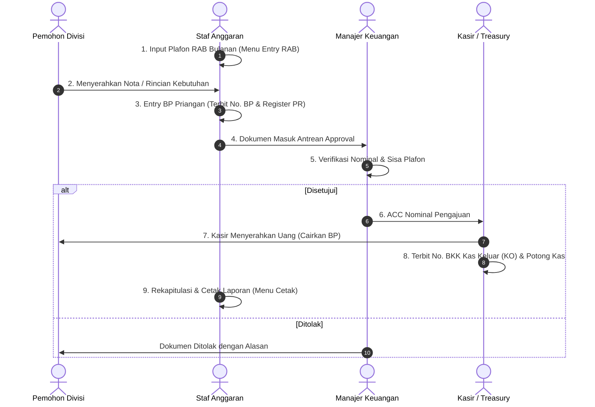

# BUKU MODUL PANDUAN LENGKAP & PRESENTASI SISTEM ANGGARAN
## HU. KABAR PRIANGAN &bull; PT. BERKAH PIKIRAN RAKYAT
**Standar Operasional Prosedur (SOP), Arsitektur Modul, Tata Kelola Penganggaran, Integrasi Pencairan Meja Kasir, serta Script Presentasi Eksekutif**  
*Alamat: Jl. Dindingari Raya No. 12, Perum Bumi Resik Panglayungan, Tasikmalaya 46134*

---

## DAFTAR ISI LENGKAP
1. [BAB I: PENDAHULUAN & LATAR BELAKANG SISTEM](#bab-i-pendahuluan--latar-belakang-sistem)
   - 1.1 Latar Belakang Modernisasi Sistem DOS ANGGARAN.EXE
   - 1.2 Matriks Hak Akses & Pemisahan Tugas (Segregation of Duties)
2. [BAB II: PANDUAN MENU 1 - TABEL (MASTER DATA)](#bab-ii-panduan-menu-1---tabel-master-data)
   - 2.1 Tabel Bidang Priangan (Master 7 Divisi Kerja)
   - 2.2 Tabel Perkiraan Priangan (Bagan Akun COA)
   - 2.3 Tabel Rekening Bank Priangan
3. [BAB III: PANDUAN MENU 2 - ENTRY (TRANSAKSI HARIAN)](#bab-iii-panduan-menu-2---entry-transaksi-harian)
   - 3.1 RAB Priangan (Plafon Anggaran Bulanan)
   - 3.2 BP Priangan (Entry Bukti Pengeluaran & Nomor Register PR)
   - 3.3 Tutup Anggaran (Proses Closing Periode)
   - 3.4 DP Kasbon (Uang Muka Operasional / Panjar)
4. [BAB IV: PANDUAN MENU 3 - CETAK (7 LAPORAN RESMI)](#bab-iv-panduan-menu-3---cetak-7-laporan-resmi)
   - 4.1 Realisasi Anggaran Seluruh Bidang Priangan
   - 4.2 Realisasi Anggaran Per Bidang Priangan
   - 4.3 Rekap BP Priangan Per Tanggal
   - 4.4 Rekap BP Priangan Per Bulan
   - 4.5 Rekap Realisasi Per Bagan Akun (COA)
   - 4.6 Cetak Ulang BP Per Tanggal (Reprint)
   - 4.7 Rekap Realisasi Per Tahun (12 Bulan Komparasi)
5. [BAB V: PANDUAN MENU 4 - FUNGSI (UTILITAS & KONTROL SISTEM)](#bab-v-panduan-menu-4---fungsi-utilitas--kontrol-sistem)
   - 5.1 Ganti Password (Keamanan Akun)
   - 5.2 Drive Data (Status Server, Database & Volume Rekaman Data)
   - 5.3 Cek Pencairan BP di Meja Kasir
   - 5.4 Buka Anggaran (Re-Open Closing Periode)
6. [BAB VI: STANDAR OPERASIONAL PROSEDUR (SOP) ALUR KERJA LENGKAP](#bab-vi-standar-operasional-prosedur-sop-alur-kerja-lengkap)
   - Alur 4 Tahap Otorisasi Pengeluaran Kas
   - Diagram Alur Kerja (Workflow Diagram)
7. [BAB VII: PANDUAN PRESENTASI & SKENARIO LIVE DEMO](#bab-vii-panduan-presentasi--skenario-live-demo)
   - 7.1 Naskah Pembuka Presentasi (Opening Speech)
   - 7.2 Urutan Skenario Live Demo di Depan Penguji / Pimpinan
   - 7.3 Antisipasi Pertanyaan Kritis (Q&A Defense)
8. [LEMBAR PENGESAHAN DOKUMEN RESMI](#lembar-pengesahan-dokumen-resmi)

---

## BAB I: PENDAHULUAN & LATAR BELAKANG SISTEM

### 1.1 Latar Belakang Modernisasi Sistem DOS ANGGARAN.EXE
Penerbitan surat kabar harian **HU. Kabar Priangan** (anak perusahaan PT. Pikiran Rakyat Bandung) telah puluhan tahun mengandalkan aplikasi berbasis sistem operasi DOS dengan program utama bernama **`ANGGARAN.EXE`**. Program tersebut terbukti andal dalam mencatat pengeluaran operasional wartawan, percetakan, dan kantor.

Namun seiring perkembangan teknologi, sistem DOS lama menghadapi berbagai keterbatasan kritikal:
1. **Data Terisolasi (Silo):** Data hanya tersimpan di satu harddisk komputer lokal dan tidak terhubung jaringan secara real-time.
2. **Pencairan Masih Manual:** Setelah staf anggaran mencetak Bukti Pengeluaran (BP), kasir harus menginput ulang ke sistem kasir terpisah (`KAS.EXE`), yang beresiko salah ketik angka atau duplikasi voucher.
3. **Laporan Terbatas:** Rekapitulasi laporan tahunan membutuhkan waktu lama karena harus menarik data disket/backup satu per satu.

Sistem web baru ini dibangun dengan tujuan modernisasi total pada infrastruktur database, namun **tetap mempertahankan 100% struktur menu asli (TABEL, ENTRY, CETAK, FUNGSI, SELESAI), kode bagian 01 s.d. 07, bagan perkiraan akuntansi, dan format nomor bukti register**, sehingga pengguna lama tidak perlu beradaptasi dari nol.

### 1.2 Matriks Hak Akses & Pemisahan Tugas (Segregation of Duties)
| Peran / Jabatan | Kewenangan & Tanggung Jawab | Akses Menu Sistem |
|---|---|---|
| **Staf Bagian Anggaran** (`role: anggaran`) | Menginput plafon RAB, membuat usulan Bukti Pengeluaran (BP), mencatat panjar kasbon, mencetak 7 laporan resmi, dan melakukan closing tutupan anggaran. | Menu TABEL, Menu ENTRY, Menu CETAK, Menu FUNGSI, Menu SELESAI. |
| **Manajer Keuangan** (`role: keuangan`) | Memverifikasi kepatutan pengeluaran, menyetujui nominal ACC anggaran, menolak usulan di luar batas anggaran, dan mengotorisasi pembukaan kembali anggaran (re-open). | Persetujuan Pengajuan (ACC/Reject), Monitoring Realisasi, Buka Periode. |
| **Kasir / Treasury** (`role: kasir`) | Menerima dokumen BP yang telah di-ACC, mencairkan uang tunai/transfer, menerbitkan nomor Bukti Kas Keluar (BKK KO), dan memotong saldo kas harian. | Meja Kasir, Pencairan BP, Buku Kas Keluar (BKK). |

---

## BAB II: PANDUAN MENU 1 - TABEL (MASTER DATA)

### 2.1 Tabel Bidang Priangan (Master 7 Divisi Kerja)
| Kode | Nama Bidang Operasional | Bagan Akun Biaya (COA) | Karakteristik Pengeluaran |
|:---:|---|:---:|---|
| **01** | Divisi Iklan | `6.00.01.01.01.02` | Komisi sales agen, promosi event koran, entertainment relasi. |
| **02** | Divisi Sirkulasi | `6.00.01.00.01.04` | Biaya ekspedisi koran, bensin armada antar koran, insentif loper. |
| **03** | Sekretariat Umum (Sekum) | `6.00.01.00.01.04` | Listrik PLN kantor, PDAM, ATK, perawatan gedung, SDM karyawan. |
| **04** | Divisi Akuntansi | `6.00.01.01.01.03` | Honor audit eksternal, administrasi pajak PPN/PPh, software. |
| **05** | Divisi Keuangan & Kasir | `6.00.01.01.01.02` | Administrasi perbankan, materai, biaya transfer, pengelolaan kas. |
| **06** | Divisi Redaksi & Wartawan | `5.00.01.01.02` | Honorarium wartawan kontributor, liputan luar kota, langganan berita. |
| **07** | Pimpinan / Management Fee | `6.00.01.01.00.00` | Rapat direksi, perjalanan pimpinan, biaya representasi perusahaan. |

---

## BAB III: PANDUAN MENU 2 - ENTRY (TRANSAKSI HARIAN)

1. **RAB Priangan (Plafon Anggaran Bulanan):**  
   Di awal bulan, staf menetapkan batas pagu maksimal tiap divisi. Contoh: Redaksi diberi plafon Rp 25.000.000, Sirkulasi Rp 12.000.000. Sistem menghitung penyerapan otomatis setiap kali BP dicairkan.
2. **BP Priangan (Entry Bukti Pengeluaran):**  
   Form input pengajuan dana. Nomor BP terbit otomatis format `BP-YYYYMM-XXXX`, namun **dapat diedit manual** sesuai nomor fisik kertas bila nota telah dicetak lebih dulu. Sistem menerbitkan nomor **Register PR** resmi.
3. **Tutup Anggaran (Closing Periode Bulanan):**  
   Dilakukan pada hari kerja terakhir setiap bulan. Saat status berubah menjadi **CLOSED**, sistem memblokir pembuatan BP baru pada bulan tersebut sehingga angka realisasi laporan bulanan terkunci sah.
4. **DP Kasbon (Uang Muka Operasional / Panjar):**  
   Mencatat panjar kerja untuk tugas luar kota wartawan atau belanja mendesak. Kasbon berstatus **Aktif** hingga pemohon menyerahkan struk nota dan staf mengklik tombol **Selesaikan Kasbon**.

---

## BAB IV: PANDUAN MENU 3 - CETAK (7 LAPORAN RESMI)

| No | Nama Laporan Resmi | Format | Fungsi & Informasi yang Ditampilkan |
|:---:|---|:---:|---|
| **01** | Realisasi Seluruh Bidang Priangan | A4 Portrait | Matriks komparasi plafon RAB, total realisasi belanja disetujui, sisa plafon, dan % penyerapan ke-7 divisi. |
| **02** | Realisasi Per Bidang Priangan | A4 Portrait | Rincian per transaksi BP pada divisi yang dipilih (misal Redaksi) beserta sisa plafon divisi bersangkutan. |
| **03** | Rekap BP Priangan Per Tanggal | A4 Landscape | Arsip rekapitulasi bukti pengeluaran berdasarkan rentang tanggal penerbitan nota. |
| **04** | Rekap BP Priangan Per Bulan | A4 Landscape | Buku pengeluaran kas bulanan komprehensif memuat Nomor BP, Register PR, dan Nomor BKK kasir. |
| **05** | Rekap Realisasi Per Bagan Akun COA | A4 Portrait | Rekapitulasi pengeluaran berdasarkan akun buku besar untuk diserahkan ke bagian Akuntansi. |
| **06** | Cetak Ulang BP Per Tanggal | A4 Voucher | Pencarian cepat bukti pengeluaran berdasarkan tanggal untuk mencetak ulang fisik voucher kasir. |
| **07** | Rekap Realisasi Per Tahun (12 Bln) | A4 Landscape | Matriks komparasi 12 bulan (Jan s.d. Des) untuk 7 divisi kerja beserta grand total tahun berjalan. |

---

## BAB V: PANDUAN MENU 4 - FUNGSI (UTILITAS & KONTROL SISTEM)

1. **Ganti Password (Keamanan Akun):**  
   Fitur pembaruan kata sandi mandiri bagi staf anggaran dengan validasi kata sandi lama untuk memastikan otoritas keuangan tidak disalahgunakan.
2. **Drive Data (Status Server & Database):**  
   Memantau koneksi database MySQL, host, direktori sistem, kapasitas penyimpanan harddisk server, serta volume rekaman baris tabel data anggaran.
3. **Cek Pencairan BP di Meja Kasir:**  
   Jembatan monitoring real-time. Staf anggaran dapat langsung memantau BP mana saja yang sudah dicairkan oleh kasir (terbit nomor BKK KO) dan mana yang masih dalam antrean loket kasir.
4. **Buka Anggaran (Re-Open Closing Periode):**  
   Fitur khusus untuk membuka kembali status closing periode tertentu jika ada nota susulan darurat yang telah diizinkan Manajer Keuangan. Setiap pembukaan anggaran wajib mencantumkan alasan resmi dalam log audit.

---

## BAB VI: STANDAR OPERASIONAL PROSEDUR (SOP) ALUR KERJA LENGKAP

---

## BAB VII: PANDUAN PRESENTASI & SKENARIO LIVE DEMO

### 7.1 Naskah Pembuka Presentasi (Opening Speech)
> *"Selamat pagi/siang Bapak/Ibu pimpinan. Hari ini saya mempresentasikan **Sistem Informasi Anggaran HU. Kabar Priangan (PT. Berkah Pikiran Rakyat)**. Sistem ini merupakan modernisasi total dari sistem legendaris DOS `ANGGARAN.EXE` ke arsitektur web modern tanpa menghilangkan 5 menu asli (TABEL, ENTRY, CETAK, FUNGSI, SELESAI), dengan keunggulan integrasi langsung ke meja kasir secara real-time."*

### 7.2 Urutan Skenario Live Demo di Depan Penguji / Pimpinan
1. **Tunjukkan Menu TABEL:** Jelaskan 7 bidang kerja operasional (01 s.d. 07) dan bagan akun COA baku HU. Kabar Priangan.
2. **Buka Menu ENTRY &rarr; Entry BP:** Buat satu simulasi pengajuan belanja Divisi Redaksi (misal: "Liputan Khusus Pilkada Rp 1.500.000"). Tunjukkan bahwa nomor BP dan nomor Register PR langsung terbit otomatis.
3. **Lakukan Approval:** Masuk sebagai Manajer Keuangan dan lakukan **ACC Nominal**.
4. **Lakukan Pencairan di Meja Kasir:** Buka meja kasir, klik **Cairkan**. Tunjukkan bahwa nomor Bukti Kas Keluar (BKK KO) langsung terbit dan saldo kas harian terpotong otomatis.
5. **Tunjukkan Menu CETAK:** Buka salah satu laporan resmi (misal Realisasi Seluruh Bidang). Tunjukkan format kop resmi PT. Berkah Pikiran Rakyat dan 3 kolom tanda tangan pejabat berwenang.
6. **Tunjukkan Menu FUNGSI:** Perlihatkan fitur **Cek Pencairan BP** dan fitur **Buka Anggaran** untuk mengatasi nota tertinggal setelah closing bulanan.

### 7.3 Antisipasi Pertanyaan Kritis (Q&A Defense)
- **T: *"Apakah staf anggaran bisa langsung mencairkan uang tunai sendiri?"***  
  **J:** *"Tidak. Sistem menerapkan **Pemisahan Kewenangan (Segregation of Duties)**. Bagian Anggaran hanya mengusulkan BP dan memantau plafon. Yang berhak memegang uang fisik dan mencairkannya adalah Kasir (Treasury)."*
- **T: *"Bagaimana jika ada nomor BP manual dari cetakan kertas lama?"***  
  **J:** *"Form input BP kita rancang fleksibel. Nomor default otomatis ada, tetapi kolom nomor BP **bisa diedit manual** sesuai nomor fisik nota."*
- **T: *"Bagaimana jika akhir bulan sudah di-closing, tapi ada nota darurat tertinggal?"***  
  **J:** *"Sistem memiliki menu **FUNGSI &rarr; Buka Anggaran**. Periode bisa dibuka kembali atas persetujuan pimpinan, dan sistem mencatat siapa yang membuka, tanggal, serta alasannya dalam log audit resmi."*

---

## LEMBAR PENGESAHAN DOKUMEN RESMI

| Dibuat & Disusun Oleh, | Diperiksa & Disetujui Oleh, | Mengetahui & Mengesahkan, |
|:---:|:---:|:---:|
|    **BAGIAN ANGGARAN** Staf Penyusun Sistem |    **RANI ANGGRAENI, SE** Manajer Keuangan |    **Drs. H. DUDI SUPRIYADI** Pemimpin Umum / Redaksi |
